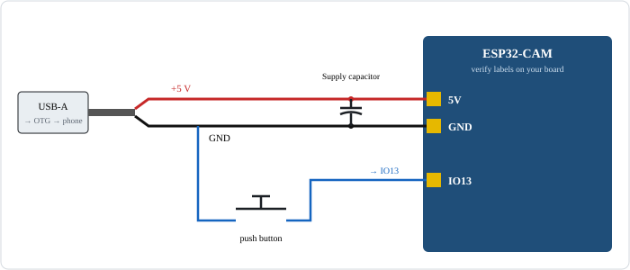
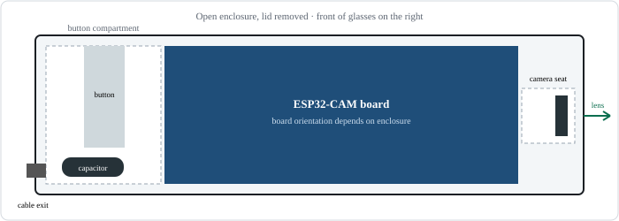
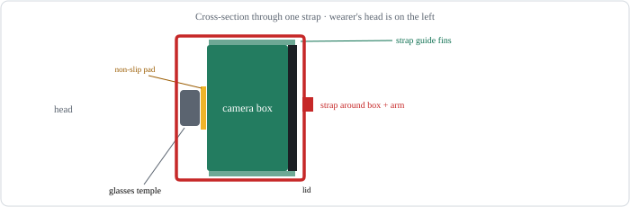

# OpenVision — Public Build Guide

OpenVision is an experimental, phone-based vision assistant. In the current working hardware prototype, a separate ESP32-CAM captures a still image and communicates with the phone over its Wi-Fi access point. A vision-language model running in the phone's browser describes the image or answers a spoken question about it. The camera is not yet mounted on the glasses frame. The phone can read the response aloud in Persian or English.

This guide documents the current working ESP32-CAM + phone prototype. The camera module is external and is not yet mounted on glasses. The repository's glasses-mount design files are intended for future integration and are not evidence of a completed wearable assembly. This is a hobbyist prototype, not a finished or safety-certified product.

## 1. System overview

1. **Camera:** the separate ESP32-CAM module captures a JPEG still image and communicates with the phone over its local Wi-Fi access point. The camera is currently external rather than mounted on the glasses.
2. **Phone application:** `index.html` runs in Chrome for Android and communicates with the camera over its local Wi-Fi network.
3. **On-device AI:** a vision-language model runs in the browser through Transformers.js and WebGPU. The phone generates a description or answer and can speak it using Android text-to-speech.

The camera does not stream continuous video. It captures a still frame on request. Image inference is performed on the phone; camera frames are not intentionally sent to a cloud inference service.

## 2. System diagram


## 3. Compatibility and project status

- The target is Chrome for Android on a device with working WebGPU support. The Samsung Galaxy S24 FE was the original development target; see [TESTED.md](TESTED.md) for the evidence currently recorded.
- Transformers.js is imported from jsDelivr; models are downloaded from their configured upstream repositories. First use requires network access. Browser caching does not guarantee complete offline operation.
- Model size and memory use vary. A model that loads on one phone may fail on another.
- The ESP32-CAM design and firmware are experimental. Verify each hardware stage on a bench before attaching it to glasses.
- This project has not been validated as an accessibility, medical, navigation, or personal-safety device.

## 4. Repository files

| Path | Purpose |
|---|---|
| `index.html` | Phone-side web application and model inference |
| `firmware/openvision_cam/openvision_cam.ino` | ESP32-CAM firmware |
| `firmware/openvision_cam/config.example.h` | Safe local credential template |
| `hardware/` | Printable and laser-cut design files |
| `docs/BOM.md` | Reference bill of materials |
| `docs/TESTED.md` | Compatibility/test record |

Model weights are not included. Review each model's licence and terms before use.

## 5. Hardware and wiring



The camera board is powered by a cable from the phone through USB-C OTG in the reference arrangement (or another suitable regulated 5 V source). **The phone communicates with the camera over local Wi-Fi/HTTP, not USB data.** The cable's data conductors are unused in the documented power-only wiring.

The design files are starting points for a future wearable assembly, not universal-fit parts. The current working camera is not mounted on glasses. Before attempting integration, check board revision, camera module, glasses-arm dimensions, cable routing, enclosure clearances, weight distribution, and strain relief.

See [BOM.md](BOM.md) for the component checklist. The firmware reference uses:

| Connection | ESP32-CAM |
|---|---|
| Button terminal A | GPIO 13 |
| Button terminal B | GND |
| Supply | 5 V and GND |

The reference build notes specify a polarized 220–330 µF / 10 V capacitor across the supply rails near the board. Observe polarity and verify the exact board pin labels. Never rely on wire colours alone.

**Power and mounting caution:** the phone's USB port may not safely power every board/cable combination. Check current draw, connector temperature, voltage stability, and strain relief. Do not wear a prototype that becomes hot, has exposed conductors, or can snag on clothing.

## 6. Firmware setup

1. Install Arduino IDE and the Espressif ESP32 board package.
2. Copy `firmware/openvision_cam/config.example.h` to `firmware/openvision_cam/config.h`.
3. Set a unique AP password of at least eight characters. If using station mode, set the station credentials too. Do not commit `config.h`.
4. Open `firmware/openvision_cam/openvision_cam.ino`.
5. Select the board and partition settings appropriate for your exact ESP32-CAM module. The source comments describe the reference configuration: ESP32 Wrover Module, PSRAM enabled, Minimal SPIFFS partition with OTA.
6. Flash using a suitable ESP32-CAM programmer.
7. Open the serial monitor and confirm that the camera starts and reports its local address.

The AP password is also used for ArduinoOTA authentication. The HTTP camera API is unauthenticated for clients on the camera network; do not expose that network or OTA service to untrusted clients. See [SECURITY.md](../SECURITY.md).

## 7. Future glasses integration

The repository includes glasses-mount and enclosure design files, but the current working ESP32-CAM is external and has not been mounted on a glasses frame. Treat mounting as a future mechanical integration task. Verify the actual board and camera dimensions, field of view, cable routing, weight distribution, strain relief, heat, and safe attachment before wearing any assembled prototype.

## 8. Fabricate and mount the enclosure





1. Open `hardware/glasses_cam_mount.scad` in OpenSCAD.
2. Select parameters matching your hardware and measure the glasses temple.
3. Render and export an STL.
4. Print a test fit before making the final part. Adjust tolerances rather than forcing the board into the enclosure.
5. Keep the lens unobstructed and orient it approximately forward, with a slight downward angle if needed.
6. Secure the enclosure without crushing the glasses arm. Add cable strain relief and enough slack for normal movement and folding.
7. Check for sharp edges, hot surfaces, loose parts, and pressure points.

The repository also contains a laser-cut alternative under `hardware/laser/`. Confirm material thickness and dimensions before ordering or cutting.

## 9. Set up the phone

1. Use a recent Chrome for Android version on a device with WebGPU support.
2. Serve the project from an HTTP/HTTPS origin supported by the browser. For local testing on the phone, run the server on the phone itself (for example, Termux) and open `http://localhost:8080/index.html`.
3. If the server runs on another computer, open that computer's reachable LAN address, not `localhost`. The camera endpoint is a separate local HTTP service; browser mixed-content and private-network restrictions may affect connectivity depending on the browser version and origin.
4. Connect the phone to the camera's Wi-Fi access point.
5. In the app settings, select the ESP32 Wi-Fi camera and confirm connection status.
6. Load a model while internet access is available. The initial download can be large.
7. Enable the preferred Persian or English Android text-to-speech voice. For spoken questions, configure speech recognition and an offline language pack if supported.

A simple local server can be started from the project directory with:

```bash
python -m http.server 8080
```

## 10. Interaction

- **Short press:** capture a still image, describe it briefly, and read the result aloud.
- **Long press:** capture a still image and enter question mode for that image.
- **Press while listening:** finish speech input and submit the question.

Exact timing and behaviour are controlled by the application and firmware versions in the repository.

## 11. Testing and limitations

- Verify camera image and button events on a workbench.
- Check that the camera points where intended and the image is upright and clear.
- Confirm stable power and check for unexpected heating during an extended bench test.
- Test short-press and long-press behaviour repeatedly.
- Test model loading and inference before relying on offline operation.
- Test offline behaviour explicitly; cached model files do not guarantee every page dependency is available offline.

Known limitations include variable WebGPU support, phone memory limits, model latency, camera compatibility, speech-recognition quality, and no continuous video analysis.

**Do not rely on OpenVision to cross streets, navigate hazards, identify people, read critical warnings, or make medical or safety decisions.** AI descriptions can be incomplete or incorrect. Keep ordinary situational awareness and other assistive tools in use.

## 12. Privacy

The intended design performs image inference locally on the phone. Network behaviour also depends on the browser, hosting origin, model download source, and third-party libraries. Review the app and dependencies before using sensitive images. The ESP32-CAM's local Wi-Fi network should use a unique password and should not be shared with untrusted users.

## 13. Licences

- Software and firmware: Apache License 2.0.
- Original hardware design files: CERN-OHL-P-2.0.
- Original project documentation: CC BY 4.0.

Third-party libraries, model weights, datasets, fonts, and external assets remain under their own licences and terms.
